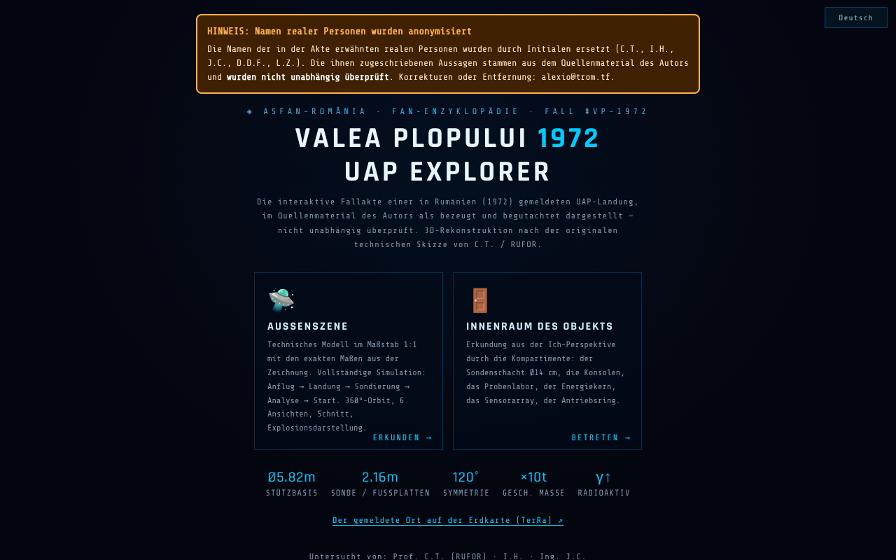

# Valea Plopului 1972 · UAP Explorer

[English](README.md) · [Română](README.ro.md) · [Français](README.fr.md) · [Italiano](README.it.md) · [Español](README.es.md) · [Português](README.pt.md) · **Deutsch** · [Magyar](README.hu.md)

**Version:** 1.3.8 · **Zuletzt aktualisiert:** 2026-10-23

Oberflächensprachen: **Română, English, Français, Italiano, Español, Português (PT), Deutsch, Magyar**

**Online / Demo:** https://chiuta.github.io/ValeaPlopului1972/

> **Fiktion / Spekulation.** Illustrative 3D-Rekonstruktion eines gemeldeten UAP-Falls (Valea Plopului, Prahova, 1972). Sie stellt keinen wissenschaftlichen Beweis dar. Das Innere des Objekts ist erfunden; die den „Theorien“ zugeordneten Prozentangaben sind Schätzungen des Autors, ohne veröffentlichte Methodik. Die Aussagen auf der Seite (einschließlich „ungeklärter Fall“) wurden hier nicht unabhängig überprüft.

Drei HTML-Seiten mit 3D-Rendering (three.js r128, lokal eingebunden, MIT-Lizenz):
- `index.html` — Menü, Dossier (technische Daten, Analyse und Theorien), Außenszene mit Simulation, erkundbares Innere, geführte Touren, Videoexport;
- `ValeaPlopului_Model3D_Tehnic.html` — technisches Außenmodell im Maßstab 1:1 (8 Sprachen);
- `ValeaPlopului_Interior3D.html` — erkundbares Innere (spekulative Rekonstruktion) (8 Sprachen).

## Verwendung
Öffne `index.html` in einem Browser mit WebGL (Desktop oder Mobilgerät). Steuerung: `H` Hilfe, `T` geführte Tour, `SPACE` Simulation; das Barrierefreiheitsfeld bietet reduzierte Bewegung, hohen Kontrast und größeren Text.

## Quellen und Einschränkungen
- Die Außenmaße stammen laut Seite aus der technischen Skizze, die Prof. Călin Turcu / RUFOR zugeschrieben wird; die genannten Ermittler sind Călin Turcu, Ion Hobana und Justin Capră. Die App enthält keine Bibliografie, und die Rechte an der Skizze und den Bildern sind nicht angegeben.
- Die „vergleichbaren“ Fälle (Valensole, Trans-en-Provence, Socorro) sind ohne Quellenverweise zusammengefasst.
- Die Seite trägt die Marke ASFAN-România / Enciclopedia FAN.
- Genannte reale Personen (Călin Turcu, Ion Hobana, Justin Capră, Dan D. Farcaș): Die Zuschreibungen und Messungen auf der Seite sind aus dem Quellmaterial des Autors wiedergegeben und **wurden nicht unabhängig überprüft**; der Hinweis „nicht unabhängig überprüft“ steht auf den drei Seiten neben ihren Namen (der Inhalt wurde nicht umgeschrieben). Die „ASFAN-Schlussfolgerung“ ist eine Schlussfolgerung des Autors/von ASFAN, nicht die einer unabhängigen wissenschaftlichen Institution.
- Der Text zu Valea Plopului ist zwischen dieser App und [TerRa](https://chiuta.github.io/TerRa/#v=2d&ufo=valea-plopului&from=valeaplopului) abgeglichen: In beiden wird der Fall mit Quellenzuschreibung dargestellt („in den zitierten Quellen als erster beglaubigter und begutachteter Fall dargestellt“) und ist **nicht unabhängig überprüft**; der Fall bleibt umstritten.

## Daten und Datenschutz
Keine Netzwerkanfragen (CSP mit `connect-src 'self'`, geprüft: 0 externe Anfragen beim Laden). Skripte sind nur per Hash erlaubt (`script-src 'self' 'sha256-…' blob:`, ohne `'unsafe-inline'`): In den drei Seiten gibt es keine `on*=`-Attribute mehr. In `index.html` werden die Optionen des Barrierefreiheitsfelds (reduzierte Bewegung, Kontrast, Textgröße, Leistungsmodus) lokal in `localStorage` gespeichert (Schlüssel `valeaplopului1972.a11y`, nur diese vier Werte, dazu die Sprachwahl, Schlüssel `valeaplopului1972.lang`; es wird nichts gesendet). Schriftarten und three.js sind eingebunden. Die Links zur freiwilligen Unterstützung öffnen sich nur per Klick. Der Videoexport erfolgt lokal im Browser; zum Teilen wird `navigator.share` verwendet, falls vorhanden.

## Rechte und Quellenangabe
**Rekonstruktion aus öffentlichen Quellen, nicht unabhängig überprüft; ohne Einwilligung der genannten Personen erstellt** (Călin Turcu, Ion Hobana, Justin Capră, Dan D. Farcaș). *Reconstruction from public sources, not independently verified; made without the consent of the people named.*

- **Teil des Autors** (Code, 3D-Modelle, Originaltexte): MIT — die erklärte Lizenz gilt NUR für diesen Teil. three.js r128: MIT.
- **Teile Dritter**: Die Prof. Călin Turcu / RUFOR zugeschriebene technische Skizze, das Bild `VP1972_og_image.png` und jedes andere Drittmaterial gehören ihren Inhabern (Rechte nicht angegeben); die MIT-Lizenz deckt sie nicht ab. *Third-party materials belong to their holders; the MIT licence does not cover them.*
- **Quellen**: Im Repository befinden sich nur die Skizze von Turcu/RUFOR und das Quellmaterial des Autors, die auf der Seite zitiert werden; Bibliografie in Arbeit. *Bibliography in progress.*
- **Berichtigung / Rücknahme**: Wenn du Rechteinhaber oder eine erwähnte Person bist und eine Berichtigung oder Rücknahme wünschst, schreibe an alexio@trom.tf; wir antworten innerhalb von 7 Tagen. *If you are a rights holder or a named person and want a correction or removal, write to alexio@trom.tf; we reply within 7 days.*
- Der Hinweis ist in der App sichtbar (Fußzeile des Menüs, Feld „Rechte und Quellenangabe“ in Model3D, Schaltfläche „Rechte“ in Interior3D).

## Lizenz
MIT für den Code des Autors, gemäß den Headern; three.js ist MIT (Hinweis in den Dateien beibehalten). Siehe `LICENSE`.

Audit: 2026-10-10 (Runde 3: Rechte und Quellenangabe)

## Verlauf / Changelog

- 1.3.8 — 2026-10-23: Die beiden 3D-Seiten deklarieren jetzt das App-Symbol (keine implizite `/favicon.ico`-Anfrage mehr über http); auf Touchscreens (`pointer: coarse`) haben die Sprachauswahlen und die Schaltflächen der 3D-Seiten ein Touch-Ziel von 44 px.
- 1.3.7 — 2026-10-23: fff-kit 1.2.0: Der Sprachschlüssel lautet jetzt `valeaplopului1972.lang` (gemeinsam für `index.html` und die beiden 3D-Seiten), die Barrierefreiheits-Einstellungen liegen unter `valeaplopului1972.a11y`; die alten Schlüssel (`vp1972_lang`, `vp1972_a11y_v1`) werden beim Start automatisch migriert (auch nach dem Import einer alten .fff.json-Sicherung). Die 3D-Seiten lesen den alten Schlüssel zusätzlich als Ersatz, bis die Hauptseite ihn migriert hat.
- 1.3.5 — 2026-10-22: fff-kit 1.1.4: Touch-Ziele und Mindestschriftgröße
- 1.3.4 — 2026-10-22: fff-kit 1.1.2: PBKDF2 mit 600.000 Iterationen, Schutz vor Clickjacking.
- 1.3.3 — 2026-10-22: Ein dauerhaftes Etikett „SPEKULATIVE REKONSTRUKTION“ über den 3D-Szenen (Außen und Innen), in die 8 Sprachen übersetzt; Text von mindestens 12 px auf Mobilgeräten.

- 1.3.2 — 2026-10-22: Die parallelen englischen Sätze in den rumänischen Hinweisen wurden entfernt (jede Sprache zeigt nur ihren eigenen Text); Meta-Beschreibung und die Beschreibung im fff-kit-Panel folgen der Oberflächensprache.
- 1.3.1 — 2026-10-21: Die Seiten `ValeaPlopului_Interior3D.html` und `ValeaPlopului_Model3D_Tehnic.html` gibt es jetzt in 8 Sprachen (Auswahl; derselbe Schlüssel `vp1972_lang` wie in `index.html`, die Sprache gilt also seitenübergreifend); „Dez. 1972“ → „1972“ (abgestimmt mit TerRa); „Poșești“ im Kopf von Model3D; Tippfehler korrigiert; Test `tests/i18n.test.mjs`. Der Text zu Valea Plopului ist zwischen dieser App und TerRa abgeglichen.
- 1.2.0 — 2026-10-18: Link im Menü zum gemeldeten Ort auf der TerRa-Karte (`#v=2d&ufo=valea-plopului`).
- 1.1.0 — 2026-10-14: Datensicherung und Kennzeichnung von Daten (fff-kit).
- 1.0.0 — 2026-10-12: Die Version und das Datum der letzten Aktualisierung werden in der App angezeigt (erste nummerierte Version; in der Fußzeile des Startmenüs).
- **Kontrast korrigiert (von Gutachtern gefundener Mangel, mit eigener Kontrastmessung reproduziert):** Die kleinen abgedunkelten Texte im Menü, in den Daten-/Analysefeldern und die Hinweise in der Szene hatten auf dem dunklen Hintergrund ein Kontrastverhältnis zwischen ~1,7:1 und 3,6:1 (axe-core hatte sie nicht gemeldet). Die Textfarben wurden in `index.html`, `ValeaPlopului_Model3D_Tehnic.html` und `ValeaPlopului_Interior3D.html` auf ≥ 4,5:1 aufgehellt, unter Beibehaltung der kühlen Farbpalette; Text und Fakten wurden nicht geändert. CSP-Hashes neu berechnet; `screenshot.png` neu erzeugt.
- **Prozentangaben der Theorien:** Unter den vier Theorien steht jetzt ein Hinweis (RO + EN), dass die Prozentangaben Schätzungen des Autors zur Übereinstimmung jeder Hypothese mit den Spuren sind, keine berechneten Wahrscheinlichkeiten, dass sich die Hypothesen nicht gegenseitig ausschließen (sie ergeben nicht 100 %) und dass Methodik und Quellen nicht veröffentlicht sind. Die Zahlen wurden nicht geändert.
- Die Formulierung im Menü und in den Metadaten („erste belegte und begutachtete UAP-Landung“) wurde umformuliert zu „gemeldete UAP-Landung … im Quellmaterial des Autors als belegt und begutachtet dargestellt — nicht unabhängig überprüft“, im Einklang mit dem Fiktions-/Spekulationshinweis (der Inhalt zu genannten Personen und Rechten wurde nicht geändert).
- Der Unterstützungsblock verdeckt nicht mehr die Ansichtsleiste in der Szene; auf den drei Seiten steht der Inhalt in `<main>`, die Überschriften haben die richtige Reihenfolge, die Bedienelemente (Auswahlfelder, Schieberegler) haben Beschriftungen; axe-core = 0 Verstöße bei 1280 und 360 px, im Menü, in der Außenszene, im Innenraum und in den geöffneten Feldern.
- Die 75 Inline-Handler (`onclick=`, `onkeydown=`, `oninput=`, `onchange=`: 52 in `index.html`, 19 in Model3D, 4 in Interior3D) wurden durch `data-*`-Attribute ersetzt, die über eine explizite Funktionstabelle direkt an die Elemente gebunden sind (kein `eval`/`Function`; die Argumente sind JSON-Literale). Die Parität wurde automatisch am Original und an der neuen Variante geprüft: dieselben Aufrufe, Argumente, `currentTarget`, `preventDefault` bei Klick, Eingabe, Leertaste, Pfeiltasten, input und change an allen Elementen. Die CSP verwendet jetzt Hashes für die beiden Skripte jeder Seite, ohne `'unsafe-inline'` für Skripte.
- Barrierefreiheitsfeld: Die Auswahl bleibt zwischen Besuchen erhalten (localStorage); eine ausdrückliche Auswahl hat Vorrang vor den Systemeinstellungen.
- `ValeaPlopului_Model3D_Tehnic.html`: Die „Synthese öffentlicher Daten“ bleibt auf den 10. Juni 2026 datiert, mit dem Vermerk „aktualisiert am 11. Oktober 2026“.
