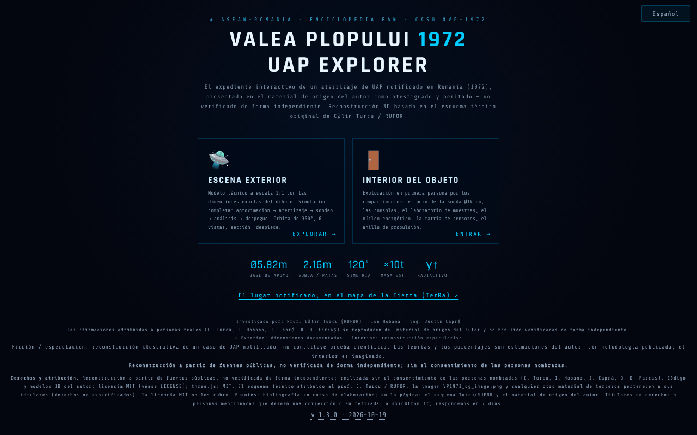

# Valea Plopului 1972 · UAP Explorer

[English](README.md) · [Română](README.ro.md) · [Français](README.fr.md) · [Italiano](README.it.md) · **Español** · [Português](README.pt.md) · [Deutsch](README.de.md) · [Magyar](README.hu.md)

**Versión:** 2.0.1 · **Última actualización:** 2026-10-27

**Estado:** estable; aviso sobre nombres de personas reales mostrado a la entrada · **Sin conexión:** completo (sin peticiones de red)

Idiomas de la interfaz: **Română, English, Français, Italiano, Español, Português (PT), Deutsch, Magyar**

**En línea / demo:** https://chiuta.github.io/ValeaPlopului1972/

> **Ficción / especulación.** Reconstrucción 3D ilustrativa de un caso UAP reportado (Valea Plopului, Prahova, 1972). No constituye prueba científica. El interior del objeto es imaginado; los porcentajes asociados a las «teorías» son estimaciones del autor, sin metodología publicada. Las afirmaciones de la página (incluido «caso sin explicar») no han sido verificadas aquí de forma independiente.

Tres páginas HTML con renderizado 3D (three.js r128, incluido localmente, licencia MIT):
- `index.html` — menú, expediente (datos técnicos, análisis y teorías), escena exterior con simulación, interior explorable, visitas guiadas, exportación de vídeo;
- `ValeaPlopului_Model3D_Tehnic.html` — modelo técnico exterior a escala 1:1 (8 idiomas);
- `ValeaPlopului_Interior3D.html` — interior explorable (reconstrucción especulativa) (8 idiomas).

## Uso
Abre `index.html` en un navegador con WebGL (escritorio o móvil). Controles: `H` ayuda, `T` visita guiada, `SPACE` simulación; el panel de accesibilidad permite movimiento reducido, alto contraste y texto más grande.

## Fuentes y limitaciones
- Las dimensiones exteriores provienen, según la página, del croquis técnico atribuido al prof. Călin Turcu / RUFOR; los investigadores mencionados son Călin Turcu, Ion Hobana y Justin Capră. No hay bibliografía en la aplicación, y los derechos sobre el croquis y las imágenes no están especificados.
- Los casos «comparables» (Valensole, Trans-en-Provence, Socorro) se resumen sin referencias a las fuentes.
- La página lleva la marca ASFAN-România / Enciclopedia FAN.
- Personas reales nombradas (Călin Turcu, Ion Hobana, Justin Capră, Dan D. Farcaș): las atribuciones y mediciones de la página se reproducen del material de origen del autor y **no han sido verificadas de forma independiente**; la nota «no verificado de forma independiente» aparece junto a sus nombres en las tres páginas (el contenido no se reescribió). La «conclusión ASFAN» es una conclusión del autor/ASFAN, no de una institución científica independiente.
- El texto sobre Valea Plopului está alineado entre esta aplicación y [TerRa](https://chiuta.github.io/TerRa/#v=2d&ufo=valea-plopului&from=valeaplopului): en ambas, el caso se presenta con atribución («presentado en las fuentes citadas como el primer caso atestiguado y peritado») y **no verificado de forma independiente**; el caso sigue siendo disputado.

## Datos y privacidad
Sin solicitudes de red (CSP con `connect-src 'self'`, verificado: 0 solicitudes externas al cargar). Los scripts solo se permiten mediante hash (`script-src 'self' 'sha256-…' blob:`, sin `'unsafe-inline'`): ya no hay atributos `on*=` en las tres páginas. En `index.html`, las opciones del panel de accesibilidad (movimiento reducido, contraste, tamaño del texto, modo de rendimiento) se guardan localmente en `localStorage` (clave `valeaplopului1972.a11y`, solo estos cuatro valores, más la elección de idioma, clave `valeaplopului1972.lang`; no se envía nada). Las fuentes y three.js están incluidos. Los enlaces de apoyo voluntario solo se abren al hacer clic. La exportación de vídeo se hace localmente en el navegador; para compartir se usa `navigator.share` si existe.

## Derechos y atribución
**Reconstrucción a partir de fuentes públicas, no verificada de forma independiente; realizada sin el consentimiento de las personas nombradas** (Călin Turcu, Ion Hobana, Justin Capră, Dan D. Farcaș). *Reconstruction from public sources, not independently verified; made without the consent of the people named.*

- **Parte del autor** (código, modelos 3D, textos originales): MIT — la licencia declarada se aplica SOLO a esta parte. three.js r128: MIT.
- **Partes de terceros**: el croquis técnico atribuido al prof. Călin Turcu / RUFOR, la imagen `VP1972_og_image.png` y cualquier otro material de terceros pertenecen a sus titulares (derechos sin especificar); la licencia MIT no los cubre. *Third-party materials belong to their holders; the MIT licence does not cover them.*
- **Fuentes**: en el repositorio solo están el croquis Turcu/RUFOR y el material de origen del autor, citados en la página; bibliografía en curso de elaboración. *Bibliography in progress.*
- **Rectificación / retirada**: si eres titular de derechos o una persona mencionada y deseas una corrección o la retirada, escribe a alexio@trom.tf; respondemos en 7 días. *If you are a rights holder or a named person and want a correction or removal, write to alexio@trom.tf; we reply within 7 days.*
- La nota es visible en la aplicación (pie del menú, panel «Derechos y atribución» en Model3D, botón «Derechos» en Interior3D).

## Licencia
MIT para el código del autor, según las cabeceras; three.js es MIT (nota conservada en los archivos). Consulta `LICENSE`.

Auditoría: 2026-10-10 (ronda 3: derechos y atribución)

## Historial / Changelog

- 1.3.8 — 2026-10-23: las dos páginas 3D declaran ahora el icono de la aplicación (sin la petición implícita de `/favicon.ico` por http); en pantallas táctiles (`pointer: coarse`) los selectores de idioma y los botones de las páginas 3D tienen un área táctil de 44 px.
- 1.3.7 — 2026-10-23: fff-kit 1.2.0: la clave del idioma es ahora `valeaplopului1972.lang` (compartida por `index.html` y las dos páginas 3D) y las preferencias de accesibilidad se guardan con `valeaplopului1972.a11y`; las claves antiguas (`vp1972_lang`, `vp1972_a11y_v1`) se migran automáticamente al iniciar (también tras importar una copia .fff.json antigua). Las páginas 3D leen también la clave antigua como alternativa hasta que la página principal la migre.
- 1.3.5 — 2026-10-22: fff-kit 1.1.4: objetivos táctiles y texto mínimo
- 1.3.4 — 2026-10-22: fff-kit 1.1.2: PBKDF2 con 600.000 iteraciones, protección anti-clickjacking.
- 1.3.3 — 2026-10-22: Una etiqueta permanente «RECONSTRUCCIÓN ESPECULATIVA» sobre las escenas 3D (exterior e interior), traducida a los 8 idiomas; texto de al menos 12 px en móvil.

- 1.3.2 — 2026-10-22: Se eliminaron las frases paralelas en inglés de los avisos en rumano (cada idioma muestra solo su propio texto); la meta descripción y la descripción del panel fff-kit siguen el idioma de la interfaz.
- 1.3.1 — 2026-10-21: las páginas `ValeaPlopului_Interior3D.html` y `ValeaPlopului_Model3D_Tehnic.html` están ahora en 8 idiomas (selector; misma clave `vp1972_lang` que `index.html`, por lo que el idioma se comparte entre páginas); «dic. 1972» → «1972» (alineado con TerRa); «Poșești» en la cabecera de Model3D; correcciones de erratas; prueba `tests/i18n.test.mjs`. El texto sobre Valea Plopului está alineado entre esta aplicación y TerRa.
- 1.2.0 — 2026-10-18: enlace en el menú al lugar reportado en el mapa de TerRa (`#v=2d&ufo=valea-plopului`).
- 1.1.0 — 2026-10-14: copia de seguridad y etiquetado de datos (fff-kit).
- 1.0.0 — 2026-10-12: la versión y la fecha de la última actualización se muestran en la aplicación (primera versión numerada; en el pie del menú de inicio).
- **Contraste corregido (defecto encontrado por los evaluadores, reproducido con una medición propia del contraste):** los textos pequeños atenuados del menú, de los paneles de datos/análisis y las indicaciones de la escena tenían una relación de contraste entre ~1,7:1 y 3,6:1 sobre el fondo oscuro (axe-core no los había señalado). Los colores del texto se aclararon hasta ≥ 4,5:1 en `index.html`, `ValeaPlopului_Model3D_Tehnic.html` y `ValeaPlopului_Interior3D.html`, manteniendo la paleta de tonos fríos; el texto y los hechos no se modificaron. Hashes CSP recalculados; `screenshot.png` regenerado.
- **Porcentajes de las teorías:** bajo las cuatro teorías aparece ahora una nota (RO + EN) que dice que los porcentajes son estimaciones del autor sobre la coherencia de cada hipótesis con las huellas, no probabilidades calculadas, que las hipótesis no se excluyen mutuamente (no suman 100 %) y que la metodología y las fuentes no están publicadas. Las cifras no se cambiaron.
- La formulación del menú y de los metadatos («primer aterrizaje UAP atestiguado y peritado») se reformuló como «aterrizaje UAP reportado … presentado en el material de origen del autor como atestiguado y peritado — no verificado de forma independiente», en consonancia con la nota de ficción/especulación (el contenido sobre las personas nombradas y los derechos no se modificó).
- El bloque de apoyo ya no tapa la barra de vistas de la escena; en las tres páginas el contenido está en `<main>`, los títulos tienen el orden correcto, los controles (selectores, deslizadores) tienen etiquetas; axe-core = 0 infracciones a 1280 y 360 px, en el menú, la escena exterior, el interior y los paneles abiertos.
- Los 75 manejadores inline (`onclick=`, `onkeydown=`, `oninput=`, `onchange=`: 52 en `index.html`, 19 en Model3D, 4 en Interior3D) se sustituyeron por atributos `data-*` enlazados directamente a los elementos mediante una tabla explícita de funciones (sin `eval`/`Function`; los argumentos son literales JSON). La paridad se verificó automáticamente en el original y en la nueva variante: mismas llamadas, argumentos, `currentTarget`, `preventDefault` para clic, Intro, Espacio, flechas, input y change en todos los elementos. La CSP usa ahora hashes para los dos scripts de cada página, sin `'unsafe-inline'` para scripts.
- Panel de accesibilidad: las elecciones se conservan entre visitas (localStorage); una elección explícita tiene prioridad sobre las preferencias del sistema.
- `ValeaPlopului_Model3D_Tehnic.html`: la «Síntesis de datos públicos» sigue fechada el 10 de junio de 2026, con la mención «actualizado el 11 de octubre de 2026».
