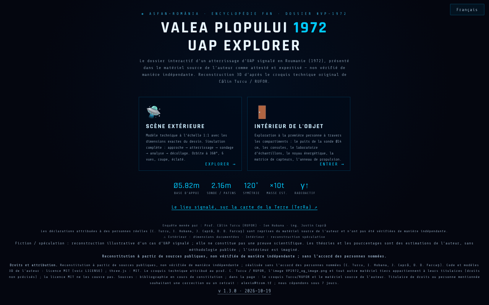

# Valea Plopului 1972 · UAP Explorer

[English](README.md) · [Română](README.ro.md) · **Français** · [Italiano](README.it.md) · [Español](README.es.md) · [Português](README.pt.md) · [Deutsch](README.de.md) · [Magyar](README.hu.md)

**Version :** 1.3.0 · **Dernière mise à jour :** 2026-10-19

Langues de l'interface : **Română, English, Français, Italiano, Español, Português (PT), Deutsch, Magyar**

**En ligne / démo :** https://chiuta.github.io/ValeaPlopului1972/

> **Fiction / spéculation.** Reconstruction 3D illustrative d'un cas UAP rapporté (Valea Plopului, Prahova, 1972). Elle ne constitue pas une preuve scientifique. L'intérieur de l'objet est imaginé ; les pourcentages attachés aux « théories » sont des estimations de l'auteur, sans méthodologie publiée. Les affirmations de la page (y compris « cas inexpliqué ») n'ont pas été vérifiées de façon indépendante ici.

Trois pages HTML avec rendu 3D (three.js r128, inclus localement, licence MIT) :
- `index.html` — menu, dossier (données techniques, analyse et théories), scène extérieure avec simulation, intérieur explorable, visites guidées, export vidéo ;
- `ValeaPlopului_Model3D_Tehnic.html` — modèle technique extérieur à l'échelle 1:1 ;
- `ValeaPlopului_Interior3D.html` — intérieur explorable (reconstruction spéculative).

## Utilisation
Ouvrez `index.html` dans un navigateur compatible WebGL (ordinateur ou mobile). Commandes : `H` aide, `T` visite guidée, `SPACE` simulation ; le panneau d'accessibilité permet de réduire les animations, d'augmenter le contraste et d'agrandir le texte.

## Sources et limites
- Les dimensions extérieures proviennent, selon la page, du croquis technique attribué au prof. Călin Turcu / RUFOR ; les enquêteurs mentionnés sont Călin Turcu, Ion Hobana et Justin Capră. L'application ne comporte aucune bibliographie, et les droits sur le croquis et les images ne sont pas précisés.
- Les cas « comparables » (Valensole, Trans-en-Provence, Socorro) sont résumés sans renvoi aux sources.
- La page porte la marque ASFAN-România / Enciclopedia FAN.
- Personnes réelles nommées (Călin Turcu, Ion Hobana, Justin Capră, Dan D. Farcaș) : les attributions et les mesures de la page sont reprises du matériel source de l'auteur et **n'ont pas été vérifiées de façon indépendante** ; la mention « non vérifié de façon indépendante » (RO/EN) apparaît à côté de leurs noms dans les trois pages (le contenu n'a pas été réécrit). La « conclusion ASFAN » est une conclusion de l'auteur/ASFAN, et non d'une institution scientifique indépendante.

## Données et confidentialité
Aucune requête réseau (CSP avec `connect-src 'self'`, vérifié : 0 requête externe au chargement). Les scripts ne sont autorisés que par hachage (`script-src 'self' 'sha256-…' blob:`, sans `'unsafe-inline'`) : il n'y a plus d'attributs `on*=` dans les trois pages. Dans `index.html`, les options du panneau d'accessibilité (animations réduites, contraste, taille du texte, mode performance) sont conservées localement dans `localStorage` (clé `vp1972_a11y_v1`, uniquement ces quatre valeurs ; rien n'est envoyé). Les polices et three.js sont inclus. Les liens de soutien volontaire ne s'ouvrent qu'au clic. L'export vidéo se fait localement dans le navigateur ; le partage utilise `navigator.share` s'il existe.

## Droits et attribution
**Reconstitution à partir de sources publiques, non vérifiée de façon indépendante ; réalisée sans l'accord des personnes nommées** (Călin Turcu, Ion Hobana, Justin Capră, Dan D. Farcaș). *Reconstruction from public sources, not independently verified; made without the consent of the people named.*

- **Partie de l'auteur** (code, modèles 3D, textes originaux) : MIT — la licence déclarée s'applique UNIQUEMENT à cette partie. three.js r128 : MIT.
- **Parties de tiers** : le croquis technique attribué au prof. Călin Turcu / RUFOR, l'image `VP1972_og_image.png` et tout autre matériel tiers appartiennent à leurs titulaires (droits non précisés) ; la licence MIT ne les couvre pas. *Third-party materials belong to their holders; the MIT licence does not cover them.*
- **Sources** : le dépôt ne contient que le croquis Turcu/RUFOR et le matériel source de l'auteur, cités dans la page ; bibliographie en cours de constitution. *Bibliography in progress.*
- **Rectification / retrait** : si vous êtes titulaire de droits ou une personne mentionnée et souhaitez une correction ou un retrait, écrivez à alexio@trom.tf ; nous répondons sous 7 jours. *If you are a rights holder or a named person and want a correction or removal, write to alexio@trom.tf; we reply within 7 days.*
- La mention est visible dans l'application (pied du menu, panneau « Droits et attribution » dans Model3D, bouton « Droits » dans Interior3D).

## Licence
MIT pour le code de l'auteur, conformément aux en-têtes ; three.js est sous licence MIT (mention conservée dans les fichiers). Voir `LICENSE`.

Audit : 2026-10-10 (tour 3 : droits et attribution)

## Historique / Changelog

- 1.2.0 — 2026-10-18 : lien dans le menu vers le lieu rapporté sur la carte TerRa (`#v=2d&ufo=valea-plopului`).
- 1.1.0 — 2026-10-14 : sauvegarde et étiquetage des données (fff-kit).
- 1.0.0 — 2026-10-12 : la version et la date de la dernière mise à jour sont affichées dans l'application (première version numérotée ; dans le pied du menu de démarrage).
- **Contraste corrigé (défaut trouvé par les évaluateurs, reproduit par notre propre mesure du contraste) :** les petits textes estompés du menu, des panneaux de données/analyse et les indications dans la scène avaient un rapport de contraste compris entre ~1,7:1 et 3,6:1 sur le fond sombre (axe-core ne les avait pas signalés). Les couleurs de texte ont été éclaircies à ≥ 4,5:1 dans `index.html`, `ValeaPlopului_Model3D_Tehnic.html` et `ValeaPlopului_Interior3D.html`, en conservant la palette aux teintes froides ; le texte et les faits n'ont pas été modifiés. Hachages CSP recalculés ; `screenshot.png` régénéré.
- **Pourcentages des théories :** sous les quatre théories figure désormais une note (RO + EN) indiquant que les pourcentages sont des estimations de l'auteur sur la cohérence de chaque hypothèse avec les traces, et non des probabilités calculées, que les hypothèses ne s'excluent pas mutuellement (elles ne totalisent pas 100 %) et que la méthodologie et les sources ne sont pas publiées. Les chiffres n'ont pas été modifiés.
- La formulation du menu et des métadonnées (« premier atterrissage UAP attesté et expertisé ») a été reformulée en « atterrissage UAP rapporté … présenté dans le matériel source de l'auteur comme attesté et expertisé — non vérifié de façon indépendante », en accord avec la note de fiction/spéculation (le contenu sur les personnes nommées et les droits n'a pas été modifié).
- Le bloc de soutien ne recouvre plus la barre de vues dans la scène ; dans les trois pages, le contenu est dans `<main>`, les titres sont dans le bon ordre, les contrôles (sélecteurs, curseurs) ont des étiquettes ; axe-core = 0 violation à 1280 et 360 px, dans le menu, la scène extérieure, l'intérieur et les panneaux ouverts.
- Les 75 gestionnaires inline (`onclick=`, `onkeydown=`, `oninput=`, `onchange=` : 52 dans `index.html`, 19 dans Model3D, 4 dans Interior3D) ont été remplacés par des attributs `data-*` liés directement aux éléments au moyen d'une table explicite de fonctions (sans `eval`/`Function` ; les arguments sont des littéraux JSON). La parité a été vérifiée automatiquement sur l'original et sur la nouvelle version : mêmes appels, arguments, `currentTarget`, `preventDefault` pour le clic, Entrée, Espace, flèches, input et change sur tous les éléments. La CSP utilise désormais des hachages pour les deux scripts de chaque page, sans `'unsafe-inline'` pour les scripts.
- Panneau d'accessibilité : les choix sont conservés entre les visites (localStorage) ; un choix explicite l'emporte sur les préférences du système.
- `ValeaPlopului_Model3D_Tehnic.html` : la « Synthèse de données publiques » reste datée du 10 juin 2026, avec la mention « mis à jour le 11 octobre 2026 ».
