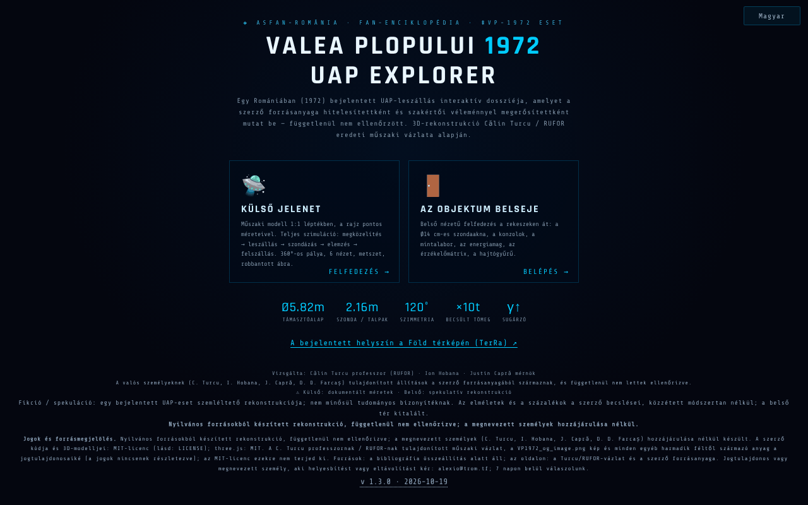

# Valea Plopului 1972 · UAP Explorer

[English](README.md) · [Română](README.ro.md) · [Français](README.fr.md) · [Italiano](README.it.md) · [Español](README.es.md) · [Português](README.pt.md) · [Deutsch](README.de.md) · **Magyar**

**Verzió:** 1.3.4 · **Utolsó frissítés:** 2026-10-22

A felület nyelvei: **Română, English, Français, Italiano, Español, Português (PT), Deutsch, Magyar**

**Élő verzió / demó:** https://chiuta.github.io/ValeaPlopului1972/

> **Fikció / spekuláció.** Egy bejelentett UAP-eset (Valea Plopului, Prahova, 1972) illusztratív 3D-rekonstrukciója. Nem minősül tudományos bizonyítéknak. A tárgy belseje kitalált; az „elméletekhez” csatolt százalékok a szerző becslései, közzétett módszertan nélkül. Az oldalon szereplő állítások (beleértve a „megmagyarázatlan eset” kifejezést) itt nem lettek függetlenül ellenőrizve.

Három HTML-oldal 3D-megjelenítéssel (three.js r128, helyben mellékelve, MIT licenc):
- `index.html` — menü, dosszié (műszaki adatok, elemzés és elméletek), külső jelenet szimulációval, bejárható belső tér, vezetett túrák, videóexport;
- `ValeaPlopului_Model3D_Tehnic.html` — műszaki külső modell 1:1 léptékben (8 nyelven);
- `ValeaPlopului_Interior3D.html` — bejárható belső tér (spekulatív rekonstrukció) (8 nyelven).

## Használat
Nyisd meg az `index.html` fájlt WebGL-képes böngészőben (asztali gépen vagy mobilon). Vezérlők: `H` súgó, `T` vezetett túra, `SPACE` szimuláció; a kisegítő lehetőségek panelje csökkentett mozgást, nagy kontrasztot és nagyobb szöveget kínál.

## Források és korlátok
- A külső méretek az oldal szerint a Călin Turcu prof. / RUFOR nevéhez kötött műszaki vázlatból származnak; a megnevezett kutatók Călin Turcu, Ion Hobana és Justin Capră. Az alkalmazásban nincs irodalomjegyzék, és a vázlathoz és a képekhez fűződő jogok nincsenek megadva.
- A „hasonló” eseteket (Valensole, Trans-en-Provence, Socorro) forrásmegjelölés nélkül foglalja össze.
- Az oldal az ASFAN-România / Enciclopedia FAN márkajelzését viseli.
- Megnevezett valós személyek (Călin Turcu, Ion Hobana, Justin Capră, Dan D. Farcaș): az oldalon szereplő tulajdonítások és mérések a szerző forrásanyagából származnak, és **nem lettek függetlenül ellenőrizve**; a „függetlenül nem ellenőrzött” megjegyzés a három oldalon a nevük mellett szerepel (a tartalom nem lett átírva). Az „ASFAN-következtetés” a szerző/ASFAN következtetése, nem egy független tudományos intézményé.
- A Valea Plopului-szöveg egységes ezen az alkalmazáson és a [TerRa](https://chiuta.github.io/TerRa/#v=2d&ufo=valea-plopului&from=valeaplopului) oldalon: mindkettő forrásmegjelöléssel mutatja be az esetet („az idézett források az első igazolt és szakértőileg vizsgált esetként mutatják be”), és **függetlenül nem ellenőrzött**; az eset vitatott marad.

## Adatok és adatvédelem
Nincsenek hálózati kérések (CSP `connect-src 'self'` beállítással, ellenőrizve: 0 külső kérés betöltéskor). A szkriptek csak hash alapján engedélyezettek (`script-src 'self' 'sha256-…' blob:`, `'unsafe-inline'` nélkül): a három oldalon már nincsenek `on*=` attribútumok. Az `index.html`-ben a kisegítő panel beállításai (csökkentett mozgás, kontraszt, szövegméret, teljesítmény mód) helyben, a `localStorage`-ban maradnak (kulcs: `vp1972_a11y_v1`, csak ez a négy érték, valamint a nyelvválasztás, kulcs: `vp1972_lang`; semmi nem kerül elküldésre). A betűtípusok és a three.js mellékelve vannak. Az önkéntes támogatás hivatkozásai csak kattintásra nyílnak meg. A videóexport helyben, a böngészőben történik; a megosztás a `navigator.share` függvényt használja, ha elérhető.

## Jogok és forrásmegjelölés
**Nyilvános forrásokból készült rekonstrukció, függetlenül nem ellenőrizve; a megnevezett személyek hozzájárulása nélkül készült** (Călin Turcu, Ion Hobana, Justin Capră, Dan D. Farcaș). *Reconstruction from public sources, not independently verified; made without the consent of the people named.*

- **A szerző része** (kód, 3D-modellek, eredeti szövegek): MIT — a megadott licenc CSAK erre a részre vonatkozik. three.js r128: MIT.
- **Harmadik felek részei**: a Călin Turcu prof. / RUFOR nevéhez kötött műszaki vázlat, a `VP1972_og_image.png` kép és minden más harmadik féltől származó anyag a jogtulajdonosaiké (a jogok nincsenek megadva); az MIT licenc nem terjed ki rájuk. *Third-party materials belong to their holders; the MIT licence does not cover them.*
- **Források**: a tárolóban csak a Turcu/RUFOR-vázlat és a szerző forrásanyaga található, amelyeket az oldal idéz; az irodalomjegyzék készül. *Bibliography in progress.*
- **Helyesbítés / visszavonás**: ha jogtulajdonos vagy említett személy vagy, és helyesbítést vagy visszavonást kérsz, írj az alexio@trom.tf címre; 7 napon belül válaszolunk. *If you are a rights holder or a named person and want a correction or removal, write to alexio@trom.tf; we reply within 7 days.*
- A megjegyzés látható az alkalmazásban (a menü lábléce, a „Jogok és forrásmegjelölés” panel a Model3D-ben, a „Jogok” gomb az Interior3D-ben).

## Licenc
MIT a szerző kódjára, a fejlécek szerint; a three.js MIT licencű (a megjegyzés megmaradt a fájlokban). Lásd: `LICENSE`.

Audit: 2026-10-10 (3. kör: jogok és forrásmegjelölés)

## Előzmények / Changelog

- 1.3.4 — 2026-10-22: fff-kit 1.1.2: PBKDF2 600 000 iterációval, clickjacking elleni védelem.
- 1.3.3 — 2026-10-22: Állandó „SPEKULATÍV REKONSTRUKCIÓ” felirat a 3D jeleneteken (külső és belső), mind a 8 nyelvre lefordítva; legalább 12 px-es szöveg mobilon.

- 1.3.2 — 2026-10-22: Eltávolítottuk a román nyelvű figyelmeztetések párhuzamos angol mondatait (minden nyelv csak a saját szövegét mutatja); a meta leírás és az fff-kit panel leírása a felület nyelvét követi.
- 1.3.1 — 2026-10-21: a `ValeaPlopului_Interior3D.html` és a `ValeaPlopului_Model3D_Tehnic.html` oldal mostantól 8 nyelven érhető el (választó; ugyanaz a `vp1972_lang` kulcs, mint az `index.html`-ben, így a nyelv az oldalak között közös); „1972. dec.” → „1972” (a TerRa-val összhangban); „Poșești” a Model3D fejlécében; elírások javítása; `tests/i18n.test.mjs` teszt. A Valea Plopului-szöveg egységes ezen az alkalmazáson és a TerRa-n.
- 1.2.0 — 2026-10-18: hivatkozás a menüben a bejelentett helyszínre a TerRa térképén (`#v=2d&ufo=valea-plopului`).
- 1.1.0 — 2026-10-14: adatmentés és adatcímkézés (fff-kit).
- 1.0.0 — 2026-10-12: a verzió és az utolsó frissítés dátuma megjelenik az alkalmazásban (az első számozott verzió; a kezdőmenü láblécében).
- **Kontraszt javítva (az értékelők által talált hiba, saját kontrasztméréssel reprodukálva):** a menü, az adat-/elemzőpanelek kis halványított szövegei és a jelenetben lévő útmutatások kontrasztaránya a sötét háttéren ~1,7:1 és 3,6:1 között volt (az axe-core nem jelezte őket). A szövegszíneket világosabbra állítottuk, ≥ 4,5:1-re az `index.html`, a `ValeaPlopului_Model3D_Tehnic.html` és a `ValeaPlopului_Interior3D.html` fájlban, a hideg árnyalatú paletta megtartásával; a szöveg és a tények nem változtak. A CSP-hashek újraszámolva; a `screenshot.png` újragenerálva.
- **Az elméletek százalékai:** a négy elmélet alatt most megjegyzés áll (RO + EN), amely kimondja, hogy a százalékok a szerző becslései arról, mennyire összeegyeztethető az egyes hipotézis a nyomokkal, nem kiszámított valószínűségek, hogy a hipotézisek nem zárják ki egymást (nem adnak ki 100%-ot), és hogy a módszertan és a források nincsenek közzétéve. A számok nem változtak.
- A menüben és a metaadatokban szereplő megfogalmazás („az első igazolt és szakértői vizsgálatnak alávetett UAP-landolás”) átfogalmazásra került: „bejelentett UAP-landolás … a szerző forrásanyagában igazoltként és szakértői vizsgálatnak alávetettként bemutatva — függetlenül nem ellenőrizve”, a fikció/spekuláció megjegyzéssel összhangban (a megnevezett személyekre és a jogokra vonatkozó tartalom nem változott).
- A támogatási blokk már nem takarja el a jelenetben lévő nézetsávot; a három oldalon a tartalom `<main>` elemben van, a címsorok helyes sorrendben követik egymást, a vezérlőknek (választók, csúszkák) vannak címkéi; axe-core = 0 szabálysértés 1280 és 360 px szélességen, a menüben, a külső jelenetben, a belső térben és a megnyitott paneleken.
- A 75 inline eseménykezelőt (`onclick=`, `onkeydown=`, `oninput=`, `onchange=`: 52 az `index.html`-ben, 19 a Model3D-ben, 4 az Interior3D-ben) `data-*` attribútumok váltották fel, amelyeket kifejezett függvénytábla köt közvetlenül az elemekhez (`eval`/`Function` nélkül; az argumentumok JSON-literálok). A paritást automatikusan ellenőriztük az eredetin és az új változaton: ugyanazok a hívások, argumentumok, `currentTarget`, `preventDefault` kattintásnál, Enter, Szóköz, nyilak, input és change esetén minden elemen. A CSP most hasheket használ az egyes oldalak két szkriptjéhez, szkriptekhez `'unsafe-inline'` nélkül.
- Kisegítő panel: a választások a látogatások között megmaradnak (localStorage); a kifejezett választás elsőbbséget élvez a rendszerbeállításokkal szemben.
- `ValeaPlopului_Model3D_Tehnic.html`: a „Nyilvános adatok szintézise” továbbra is 2026. június 10-i keltezésű, „frissítve 2026. október 11-én” megjegyzéssel.
