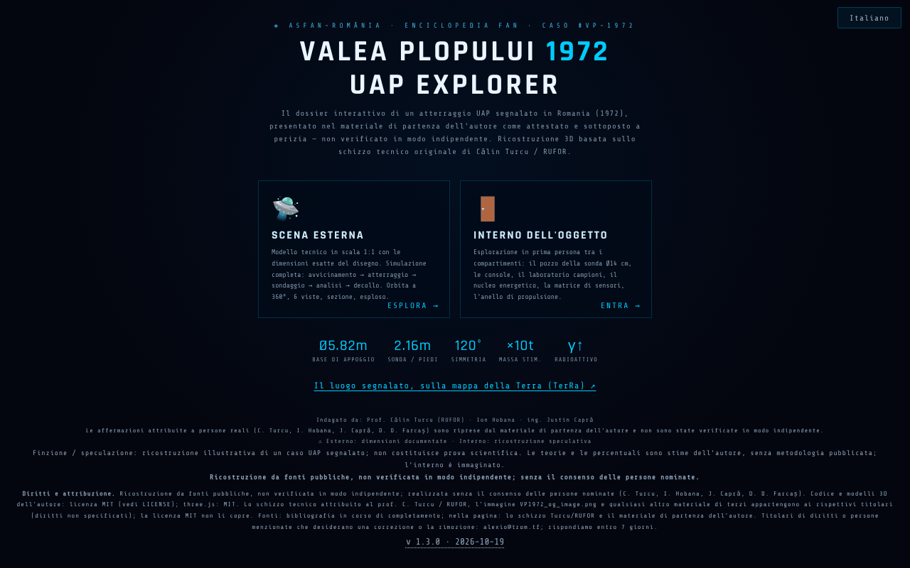

# Valea Plopului 1972 · UAP Explorer

[English](README.md) · [Română](README.ro.md) · [Français](README.fr.md) · **Italiano** · [Español](README.es.md) · [Português](README.pt.md) · [Deutsch](README.de.md) · [Magyar](README.hu.md)

**Versione:** 1.3.5 · **Ultimo aggiornamento:** 2026-10-22

Lingue dell'interfaccia: **Română, English, Français, Italiano, Español, Português (PT), Deutsch, Magyar**

**Online / demo:** https://chiuta.github.io/ValeaPlopului1972/

> **Finzione / speculazione.** Ricostruzione 3D illustrativa di un caso UAP segnalato (Valea Plopului, Prahova, 1972). Non costituisce prova scientifica. L'interno dell'oggetto è immaginato; le percentuali associate alle «teorie» sono stime dell'autore, senza metodologia pubblicata. Le affermazioni presenti nella pagina (compreso «caso inspiegato») non sono state verificate qui in modo indipendente.

Tre pagine HTML con rendering 3D (three.js r128, incluso localmente, licenza MIT):
- `index.html` — menu, dossier (dati tecnici, analisi e teorie), scena esterna con simulazione, interno esplorabile, visite guidate, esportazione video;
- `ValeaPlopului_Model3D_Tehnic.html` — modello tecnico esterno in scala 1:1 (8 lingue);
- `ValeaPlopului_Interior3D.html` — interno esplorabile (ricostruzione speculativa) (8 lingue).

## Utilizzo
Apri `index.html` in un browser con WebGL (desktop o mobile). Comandi: `H` aiuto, `T` visita guidata, `SPACE` simulazione; il pannello di accessibilità consente movimento ridotto, contrasto elevato e testo più grande.

## Fonti e limiti
- Le dimensioni esterne provengono, secondo la pagina, dallo schizzo tecnico attribuito al prof. Călin Turcu / RUFOR; gli investigatori menzionati sono Călin Turcu, Ion Hobana e Justin Capră. Nell'app non c'è bibliografia, e i diritti sullo schizzo e sulle immagini non sono specificati.
- I casi «comparabili» (Valensole, Trans-en-Provence, Socorro) sono riassunti senza rimandi alle fonti.
- La pagina riporta il marchio ASFAN-România / Enciclopedia FAN.
- Persone reali nominate (Călin Turcu, Ion Hobana, Justin Capră, Dan D. Farcaș): le attribuzioni e le misurazioni nella pagina sono riprese dal materiale di partenza dell'autore e **non sono state verificate in modo indipendente**; la nota «non verificato in modo indipendente» compare accanto ai loro nomi nelle tre pagine (il contenuto non è stato riscritto). La «conclusione ASFAN» è una conclusione dell'autore/ASFAN, non di un'istituzione scientifica indipendente.
- Il testo su Valea Plopului è allineato tra questa app e [TerRa](https://chiuta.github.io/TerRa/#v=2d&ufo=valea-plopului&from=valeaplopului): in entrambe il caso è presentato in forma attribuita («presentato nelle fonti citate come il primo caso attestato e sottoposto a perizia») e **non verificato in modo indipendente**; il caso resta controverso.

## Dati e privacy
Nessuna richiesta di rete (CSP con `connect-src 'self'`, verificato: 0 richieste esterne al caricamento). Gli script sono consentiti solo tramite hash (`script-src 'self' 'sha256-…' blob:`, senza `'unsafe-inline'`): nelle tre pagine non ci sono più attributi `on*=`. In `index.html`, le opzioni del pannello di accessibilità (movimento ridotto, contrasto, dimensione del testo, modalità prestazioni) sono conservate localmente in `localStorage` (chiave `vp1972_a11y_v1`, solo questi quattro valori, più la scelta della lingua, chiave `vp1972_lang`; non viene inviato nulla). I font e three.js sono inclusi. I link di sostegno volontario si aprono solo al clic. L'esportazione video avviene localmente nel browser; la condivisione usa `navigator.share` se disponibile.

## Diritti e attribuzione
**Ricostruzione da fonti pubbliche, non verificata in modo indipendente; realizzata senza il consenso delle persone nominate** (Călin Turcu, Ion Hobana, Justin Capră, Dan D. Farcaș). *Reconstruction from public sources, not independently verified; made without the consent of the people named.*

- **Parte dell'autore** (codice, modelli 3D, testi originali): MIT — la licenza dichiarata si applica SOLO a questa parte. three.js r128: MIT.
- **Parti di terzi**: lo schizzo tecnico attribuito al prof. Călin Turcu / RUFOR, l'immagine `VP1972_og_image.png` e qualsiasi altro materiale di terzi appartengono ai rispettivi titolari (diritti non specificati); la licenza MIT non li copre. *Third-party materials belong to their holders; the MIT licence does not cover them.*
- **Fonti**: nel repository ci sono solo lo schizzo Turcu/RUFOR e il materiale di partenza dell'autore, citati nella pagina; bibliografia in corso di completamento. *Bibliography in progress.*
- **Rettifica / ritiro**: se sei titolare di diritti o una persona menzionata e desideri una correzione o il ritiro, scrivi a alexio@trom.tf; rispondiamo entro 7 giorni. *If you are a rights holder or a named person and want a correction or removal, write to alexio@trom.tf; we reply within 7 days.*
- La nota è visibile nell'app (piè di pagina del menu, pannello «Diritti e attribuzione» in Model3D, pulsante «Diritti» in Interior3D).

## Licenza
MIT per il codice dell'autore, secondo le intestazioni; three.js è MIT (nota conservata nei file). Vedi `LICENSE`.

Audit: 2026-10-10 (round 3: diritti e attribuzione)

## Cronologia / Changelog

- 1.3.5 — 2026-10-22: fff-kit 1.1.4: bersagli touch e testo minimo
- 1.3.4 — 2026-10-22: fff-kit 1.1.2: PBKDF2 a 600.000 iterazioni, protezione anti-clickjacking.
- 1.3.3 — 2026-10-22: Un'etichetta permanente «RICOSTRUZIONE SPECULATIVA» sulle scene 3D (esterno e interno), tradotta nelle 8 lingue; testo di almeno 12 px su mobile.

- 1.3.2 — 2026-10-22: Sono state rimosse le frasi parallele in inglese dagli avvisi in rumeno (ogni lingua mostra solo il proprio testo); la meta descrizione e la descrizione del pannello fff-kit seguono la lingua dell'interfaccia.
- 1.3.1 — 2026-10-21: le pagine `ValeaPlopului_Interior3D.html` e `ValeaPlopului_Model3D_Tehnic.html` sono ora in 8 lingue (selettore; stessa chiave `vp1972_lang` di `index.html`, quindi la lingua è condivisa tra le pagine); «dic. 1972» → «1972» (allineato a TerRa); «Poșești» nell'intestazione di Model3D; correzioni di refusi; test `tests/i18n.test.mjs`. Il testo su Valea Plopului è allineato tra questa app e TerRa.
- 1.2.0 — 2026-10-18: link nel menu verso il luogo segnalato sulla mappa TerRa (`#v=2d&ufo=valea-plopului`).
- 1.1.0 — 2026-10-14: backup ed etichettatura dei dati (fff-kit).
- 1.0.0 — 2026-10-12: la versione e la data dell'ultimo aggiornamento sono mostrate nell'app (prima versione numerata; nel piè di pagina del menu iniziale).
- **Contrasto corretto (difetto trovato dai valutatori, riprodotto con una nostra misurazione del contrasto):** i piccoli testi attenuati nel menu, nei pannelli dati/analisi e le indicazioni nella scena avevano un rapporto di contrasto tra ~1,7:1 e 3,6:1 sullo sfondo scuro (axe-core non li aveva segnalati). I colori del testo sono stati schiariti fino a ≥ 4,5:1 in `index.html`, `ValeaPlopului_Model3D_Tehnic.html` e `ValeaPlopului_Interior3D.html`, mantenendo la tavolozza dalle tonalità fredde; il testo e i fatti non sono stati modificati. Hash CSP ricalcolati; `screenshot.png` rigenerato.
- **Percentuali delle teorie:** sotto le quattro teorie compare ora una nota (RO + EN) che dice che le percentuali sono stime dell'autore sulla coerenza di ciascuna ipotesi con le tracce, non probabilità calcolate, che le ipotesi non si escludono a vicenda (non sommano 100%) e che metodologia e fonti non sono pubblicate. Le cifre non sono state modificate.
- La formulazione nel menu e nei metadati («primo atterraggio UAP attestato e sottoposto a perizia») è stata riformulata come «atterraggio UAP segnalato … presentato nel materiale di partenza dell'autore come attestato e sottoposto a perizia — non verificato in modo indipendente», in accordo con la nota di finzione/speculazione (il contenuto sulle persone nominate e sui diritti non è stato modificato).
- Il blocco di sostegno non copre più la barra delle viste nella scena; nelle tre pagine il contenuto è in `<main>`, i titoli sono nell'ordine corretto, i controlli (selettori, cursori) hanno etichette; axe-core = 0 violazioni a 1280 e 360 px, nel menu, nella scena esterna, nell'interno e nei pannelli aperti.
- I 75 gestori inline (`onclick=`, `onkeydown=`, `oninput=`, `onchange=`: 52 in `index.html`, 19 in Model3D, 4 in Interior3D) sono stati sostituiti con attributi `data-*` collegati direttamente agli elementi tramite una tabella esplicita di funzioni (senza `eval`/`Function`; gli argomenti sono letterali JSON). La parità è stata verificata automaticamente sull'originale e sulla nuova versione: stesse chiamate, argomenti, `currentTarget`, `preventDefault` per clic, Invio, Spazio, frecce, input e change su tutti gli elementi. La CSP usa ora gli hash per i due script di ogni pagina, senza `'unsafe-inline'` per gli script.
- Pannello di accessibilità: le scelte vengono conservate tra le visite (localStorage); una scelta esplicita ha la priorità sulle preferenze di sistema.
- `ValeaPlopului_Model3D_Tehnic.html`: la «Sintesi dei dati pubblici» resta datata 10 giugno 2026, con la dicitura «aggiornato l'11 ottobre 2026».
