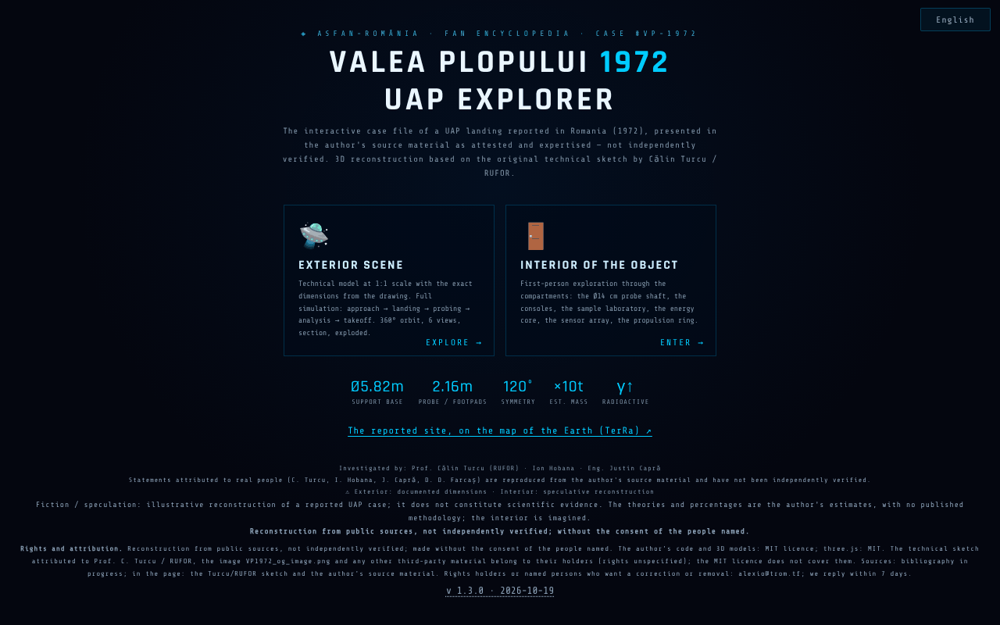

# Valea Plopului 1972 · UAP Explorer

**English** · [Română](README.ro.md) · [Français](README.fr.md) · [Italiano](README.it.md) · [Español](README.es.md) · [Português](README.pt.md) · [Deutsch](README.de.md) · [Magyar](README.hu.md)

**Version:** 2.0.1 · **Last updated:** 2026-10-27

**Status:** stable; warning about real persons' names shown on entry · **Offline:** complete (no network requests)

Interface languages: **Română, English, Français, Italiano, Español, Português (PT), Deutsch, Magyar**

**Live / demo:** https://chiuta.github.io/ValeaPlopului1972/

> **Fiction / speculation.** Illustrative 3D reconstruction of a reported UAP case (Valea Plopului, Prahova, 1972). It does not constitute scientific evidence. The interior of the object is imagined; the percentages attached to the "theories" are the author's estimates, with no published methodology. The claims on the page (including "unexplained case") have not been independently verified here.

Three HTML pages with 3D rendering (three.js r128, included locally, MIT license):
- `index.html` — menu, dossier (technical data, analysis and theories), the exterior scene with simulation, explorable interior, guided tours, video export;
- `ValeaPlopului_Model3D_Tehnic.html` — technical exterior model at 1:1 scale (8 languages);
- `ValeaPlopului_Interior3D.html` — explorable interior (speculative reconstruction) (8 languages).

## Usage
Open `index.html` in a WebGL-capable browser (desktop or mobile). Controls: `H` help, `T` guided tour, `SPACE` simulation; the accessibility panel offers reduced motion, high contrast and larger text.

## Sources and limitations
- The exterior dimensions come, according to the page, from the technical sketch attributed to Prof. Călin Turcu / RUFOR; the investigators mentioned are Călin Turcu, Ion Hobana and Justin Capră. There is no bibliography in the app, and the rights to the sketch and images are not specified.
- The "comparable" cases (Valensole, Trans-en-Provence, Socorro) are summarized without references to sources.
- The page bears the ASFAN-România / Enciclopedia FAN brand.
- Real named persons (Călin Turcu, Ion Hobana, Justin Capră, Dan D. Farcaș): the attributions and measurements on the page are reproduced from the author's source material and **have not been independently verified**; the note "not independently verified" appears next to their names on the three pages (the content was not rewritten). The "ASFAN conclusion" is a conclusion of the author/ASFAN, not of an independent scientific institution.
- The Valea Plopului text is aligned between this app and [TerRa](https://chiuta.github.io/TerRa/#v=2d&ufo=valea-plopului&from=valeaplopului): in both, the case is presented as attributed ("presented in the cited sources as the first attested and expert-assessed case") and **not independently verified**; the case remains disputed.

## Data and privacy
No network requests (CSP with `connect-src 'self'`, verified: 0 external requests on load). Scripts are allowed only by hash (`script-src 'self' 'sha256-…' blob:`, without `'unsafe-inline'`): there are no more `on*=` attributes in the three pages. In `index.html`, the options of the accessibility panel (reduced motion, contrast, text size, performance mode) are kept locally in `localStorage` (key `valeaplopului1972.a11y`, only these four values, plus the language choice, key `valeaplopului1972.lang`; nothing is sent). The fonts and three.js are included. The voluntary-support links open only on click. Video export is done locally in the browser; sharing uses `navigator.share` if available.

## Rights and attribution
**Reconstruction from public sources, not independently verified; made without the consent of the people named** (Călin Turcu, Ion Hobana, Justin Capră, Dan D. Farcaș).

- **The author's part** (code, 3D models, original texts): MIT — the declared license applies ONLY to this part. three.js r128: MIT.
- **Third-party parts**: the technical sketch attributed to Prof. Călin Turcu / RUFOR, the image `VP1972_og_image.png` and any other third-party material belong to their holders (rights unspecified); the MIT license does not cover them.
- **Sources**: the repo contains only the Turcu/RUFOR sketch and the author's source material, cited in the page; bibliography in progress.
- **Correction / withdrawal**: if you are a rights holder or a person mentioned and want a correction or withdrawal, write to alexio@trom.tf; we reply within 7 days.
- The note is visible in the app (menu footer, the "Rights and attribution" panel in Model3D, the "Rights" button in Interior3D).

## Warning: names of real persons (2026-10-27)

At the entrance of all three pages (start menu in `index.html`; a box at the top of `ValeaPlopului_Model3D_Tehnic.html` and `ValeaPlopului_Interior3D.html`, collapsible, in 8 languages) there is now a clearly visible warning: the application contains the names of real people (Călin Turcu, Ion Hobana, Justin Capră, Dan D. Farcaș) used **without their consent**. **Recommendation:** the author should anonymise the names or obtain the people's consent before wide distribution. **The decision to anonymise remains the author's**: nothing was anonymised or deleted in this update.

## License
MIT for the author's code, per the headers; three.js is MIT (note kept in the files). See `LICENSE`.

Audit: 2026-10-10 (round 3: rights and attribution)

## History / Changelog

- 1.3.8 — 2026-10-23: the two 3D pages now declare the application icon (no more implicit `/favicon.ico` request when served over http); on touch screens (`pointer: coarse`) the language selectors and the buttons of the 3D pages have a 44 px touch target.
- 1.3.7 — 2026-10-23: fff-kit 1.2.0: the language key is now `valeaplopului1972.lang` (shared by `index.html` and the two 3D pages) and the accessibility preferences are stored under `valeaplopului1972.a11y`; the old keys (`vp1972_lang`, `vp1972_a11y_v1`) are migrated automatically at start-up (also after importing an old .fff.json backup). The 3D pages also read the old key as a fallback until the main page has migrated it.
- 1.3.5 — 2026-10-22: fff-kit 1.1.4: touch targets and minimum text size
- 1.3.4 — 2026-10-22: fff-kit 1.1.2: PBKDF2 600,000 iterations, anti-clickjacking protection.
- 1.3.3 — 2026-10-22: A permanent "SPECULATIVE RECONSTRUCTION" label over the 3D scenes (exterior and interior), translated into the 8 languages; text of at least 12 px on mobile.

- 1.3.2 — 2026-10-22: The parallel English sentences in the Romanian disclaimers were removed (each language now shows its own text only); the meta description and the fff-kit panel description follow the interface language.
- 1.3.1 — 2026-10-21: `ValeaPlopului_Interior3D.html` and `ValeaPlopului_Model3D_Tehnic.html` are now available in 8 languages (selector; same `valeaplopului1972.lang` key as `index.html`, so the language is shared across pages); "Dec. 1972" → "1972" (aligned with TerRa); "Poșești" in the Model3D header; typo fixes; test `tests/i18n.test.mjs`. The Valea Plopului text is aligned between this app and TerRa.
- 1.2.0 — 2026-10-18: Menu link to the reported location on the TerRa map (`#v=2d&ufo=valea-plopului`).
- 1.1.0 — 2026-10-14: Data backup and labelling (fff-kit).
- 1.0.0 — 2026-10-12: the version and the date of the last update are shown in the app (first numbered version; in the footer of the start menu).
- **Contrast fixed (defect found by evaluators, reproduced with our own contrast measurement):** the small dimmed texts in the menu, the data/analysis panels and the hints in the scene had a contrast ratio between ~1.7:1 and 3.6:1 on the dark background (axe-core had not flagged them). The text colors were lightened to ≥ 4.5:1 in `index.html`, `ValeaPlopului_Model3D_Tehnic.html` and `ValeaPlopului_Interior3D.html`, keeping the cool-toned palette; the text and the facts were not changed. CSP hashes recomputed; `screenshot.png` regenerated.
- **Theory percentages:** under the four theories there is now a note (RO + EN) saying that the percentages are the author's estimates of how consistent each hypothesis is with the traces, not calculated probabilities, that the hypotheses are not mutually exclusive (they do not add up to 100%) and that the methodology and sources are not published. The figures were not changed.
- The wording in the menu and in the metadata ("first attested and expert-assessed UAP landing") was rephrased as "reported UAP landing … presented in the author's source material as attested and expert-assessed — not independently verified", in line with the fiction/speculation note (the content about named persons and rights was not changed).
- The support block no longer covers the views bar in the scene; on the three pages the content is in `<main>`, the headings are in the correct order, the controls (selectors, sliders) have labels; axe-core = 0 violations at 1280 and 360 px, in the menu, the exterior scene, the interior and the opened panels.
- The 75 inline handlers (`onclick=`, `onkeydown=`, `oninput=`, `onchange=`: 52 in `index.html`, 19 in Model3D, 4 in Interior3D) were replaced with `data-*` attributes bound directly to the elements through an explicit table of functions (no `eval`/`Function`; the arguments are JSON literals). Parity was verified automatically on the original and on the new version: the same calls, arguments, `currentTarget`, `preventDefault` for click, Enter, Space, arrows, input and change on all elements. The CSP now uses hashes for the two scripts in each page, without `'unsafe-inline'` for scripts.
- Accessibility panel: choices are kept between visits (localStorage); an explicit choice takes priority over system preferences.
- `ValeaPlopului_Model3D_Tehnic.html`: the "Public data synthesis" remains dated 10 June 2026, with the note "updated 11 October 2026".
