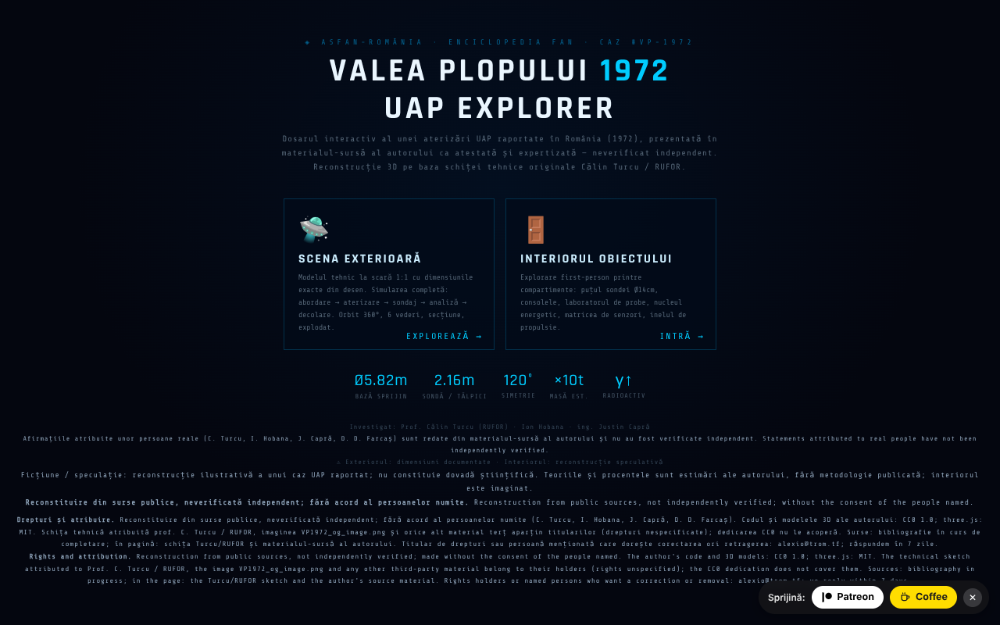

# Valea Plopului 1972 · UAP Explorer

**Live / demo:** https://chiuta.github.io/ValeaPlopului1972/

> **Ficțiune / speculație.** Reconstrucție 3D ilustrativă a unui caz UAP raportat (Valea Plopului, Prahova, 1972). Nu constituie dovadă științifică. Interiorul obiectului este imaginat; procentele atașate „teoriilor” sunt estimări ale autorului, fără metodologie publicată. Afirmațiile din pagină (inclusiv „caz neexplicat”) nu sunt verificate independent aici.

Trei pagini HTML cu randare 3D (three.js r128, inclus local, licență MIT):
- `index.html` — meniu, dosar (date tehnice, analiză și teorii), scena exterioară cu simulare, interior explorabil, tururi ghidate, export video;
- `ValeaPlopului_Model3D_Tehnic.html` — model tehnic exterior la scară 1:1;
- `ValeaPlopului_Interior3D.html` — interior explorabil (reconstrucție speculativă).

## Utilizare
Deschide `index.html` într-un browser cu WebGL (desktop sau mobil). Comenzi: `H` ajutor, `T` tur ghidat, `SPACE` simulare; panoul de accesibilitate permite mișcare redusă, contrast ridicat și text mai mare.

## Surse și limitări
- Dimensiunile exterioare provin, conform paginii, din schița tehnică atribuită prof. Călin Turcu / RUFOR; investigatorii menționați sunt Călin Turcu, Ion Hobana și Justin Capră. Nu există bibliografie în aplicație, iar drepturile asupra schiței și imaginilor nu sunt precizate.
- Cazurile „comparabile” (Valensole, Trans-en-Provence, Socorro) sunt rezumate fără trimiteri la surse.
- Pagina poartă marca ASFAN-România / Enciclopedia FAN.
- Persoane reale numite (Călin Turcu, Ion Hobana, Justin Capră, Dan D. Farcaș): atribuirile și măsurătorile din pagină sunt redate din materialul-sursă al autorului și **nu au fost verificate independent**; nota „neverificat independent” (RO/EN) apare lângă numele lor în cele trei pagini (conținutul nu a fost rescris). „Concluzia ASFAN” este o concluzie a autorului/ASFAN, nu a unei instituții științifice independente.

## Date și confidențialitate
Fără cereri de rețea (CSP cu `connect-src 'self'`, verificat: 0 cereri externe la încărcare). Fonturile și three.js sunt incluse. Linkurile de sprijin voluntar se deschid doar la click. Exportul video se face local în browser; partajarea folosește `navigator.share` dacă există.

## Drepturi și atribuire
**Reconstituire din surse publice, neverificată independent; fără acord al persoanelor numite** (Călin Turcu, Ion Hobana, Justin Capră, Dan D. Farcaș). *Reconstruction from public sources, not independently verified; made without the consent of the people named.*

- **Partea autorului** (cod, modele 3D, texte originale): CC0 1.0 — licența declarată se aplică DOAR acestei părți. three.js r128: MIT.
- **Părți ale terților**: schița tehnică atribuită prof. Călin Turcu / RUFOR, imaginea `VP1972_og_image.png` și orice alt material terț sunt ale titularilor (drepturi nespecificate); dedicarea CC0 nu le acoperă. *Third-party materials belong to their holders; the CC0 dedication does not cover them.*
- **Surse**: în repo există doar schița Turcu/RUFOR și materialul-sursă al autorului, citate în pagină; bibliografie în curs de completare. *Bibliography in progress.*
- **Rectificare / retragere**: dacă ești titular de drepturi sau persoană menționată și dorești corectarea sau retragerea, scrie la alexio@trom.tf; răspundem în 7 zile. *If you are a rights holder or a named person and want a correction or removal, write to alexio@trom.tf; we reply within 7 days.*
- Nota este vizibilă în aplicație (subsolul meniului, panoul „Drepturi și atribuire" din Model3D, butonul „Drepturi" din Interior3D).

## Licență
CC0 1.0 (domeniu public) pentru codul autorului, conform antetelor; three.js este MIT (notă păstrată în fișiere). Vezi `LICENSE`.

Audit: 2026-10-10 (rundă 3: drepturi și atribuire)

## Istoric / Changelog
Ultima actualizare: 11 octombrie 2026 (fără număr de versiune în aplicație).
- Formularea din meniu și din metadate („prima aterizare UAP atestată și expertizată”) a fost reformulată ca „aterizare UAP raportată … prezentată în materialul-sursă al autorului ca atestată și expertizată — neverificat independent”, în acord cu nota de ficțiune/speculație (conținutul despre persoane numite și drepturile nu au fost modificate).
- Blocul de sprijin nu mai acoperă bara de vederi din scenă; pe cele trei pagini conținutul este în `<main>`, titlurile au ordine corectă, controalele (selectoare, glisoare) au etichete; axe-core = 0 violări la 1280 și 360 px, în meniu, scena exterioară, interior și panourile deschise.
- Rămân 52 de handlere inline (`onclick=` etc.) în `index.html` (CSP-ul permite scripturile inline); nu au fost eliminate pentru a evita regresii în aplicația 3D.
- `ValeaPlopului_Model3D_Tehnic.html`: „Sinteză date publice” rămâne datată 10 iunie 2026, cu mențiunea „actualizat 11 octombrie 2026”.
