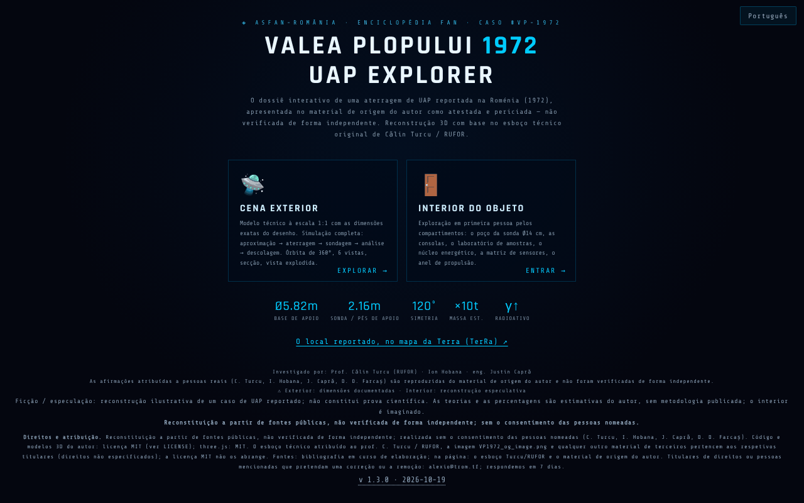

# Valea Plopului 1972 · UAP Explorer

[English](README.md) · [Română](README.ro.md) · [Français](README.fr.md) · [Italiano](README.it.md) · [Español](README.es.md) · **Português** · [Deutsch](README.de.md) · [Magyar](README.hu.md)

**Versão:** 1.3.1 · **Última atualização:** 2026-10-21

Idiomas da interface: **Română, English, Français, Italiano, Español, Português (PT), Deutsch, Magyar**

**Online / demonstração:** https://chiuta.github.io/ValeaPlopului1972/

> **Ficção / especulação.** Reconstrução 3D ilustrativa de um caso UAP reportado (Valea Plopului, Prahova, 1972). Não constitui prova científica. O interior do objeto é imaginado; as percentagens associadas às «teorias» são estimativas do autor, sem metodologia publicada. As afirmações da página (incluindo «caso por explicar») não foram aqui verificadas de forma independente.

Três páginas HTML com renderização 3D (three.js r128, incluído localmente, licença MIT):
- `index.html` — menu, dossiê (dados técnicos, análise e teorias), cena exterior com simulação, interior explorável, visitas guiadas, exportação de vídeo;
- `ValeaPlopului_Model3D_Tehnic.html` — modelo técnico exterior à escala 1:1 (8 idiomas);
- `ValeaPlopului_Interior3D.html` — interior explorável (reconstrução especulativa) (8 idiomas).

## Utilização
Abre `index.html` num navegador com WebGL (computador ou telemóvel). Comandos: `H` ajuda, `T` visita guiada, `SPACE` simulação; o painel de acessibilidade permite movimento reduzido, contraste elevado e texto maior.

## Fontes e limitações
- As dimensões exteriores provêm, segundo a página, do esboço técnico atribuído ao prof. Călin Turcu / RUFOR; os investigadores mencionados são Călin Turcu, Ion Hobana e Justin Capră. Não existe bibliografia na aplicação, e os direitos sobre o esboço e as imagens não são especificados.
- Os casos «comparáveis» (Valensole, Trans-en-Provence, Socorro) são resumidos sem remissões para as fontes.
- A página exibe a marca ASFAN-România / Enciclopedia FAN.
- Pessoas reais nomeadas (Călin Turcu, Ion Hobana, Justin Capră, Dan D. Farcaș): as atribuições e medições da página são reproduzidas do material de origem do autor e **não foram verificadas de forma independente**; a nota «não verificado de forma independente» aparece junto dos seus nomes nas três páginas (o conteúdo não foi reescrito). A «conclusão ASFAN» é uma conclusão do autor/ASFAN, não de uma instituição científica independente.
- O texto sobre Valea Plopului está alinhado entre esta aplicação e o [TerRa](https://chiuta.github.io/TerRa/#v=2d&ufo=valea-plopului&from=valeaplopului): em ambas, o caso é apresentado com atribuição («apresentado nas fontes citadas como o primeiro caso atestado e periciado») e **não verificado de forma independente**; o caso continua disputado.

## Dados e privacidade
Sem pedidos de rede (CSP com `connect-src 'self'`, verificado: 0 pedidos externos ao carregar). Os scripts são permitidos apenas por hash (`script-src 'self' 'sha256-…' blob:`, sem `'unsafe-inline'`): já não existem atributos `on*=` nas três páginas. Em `index.html`, as opções do painel de acessibilidade (movimento reduzido, contraste, tamanho do texto, modo de desempenho) são guardadas localmente em `localStorage` (chave `vp1972_a11y_v1`, apenas estes quatro valores, mais a escolha do idioma, chave `vp1972_lang`; nada é enviado). Os tipos de letra e o three.js estão incluídos. As ligações de apoio voluntário só se abrem ao clicar. A exportação de vídeo é feita localmente no navegador; a partilha usa `navigator.share`, se existir.

## Direitos e atribuição
**Reconstituição a partir de fontes públicas, não verificada de forma independente; feita sem o consentimento das pessoas nomeadas** (Călin Turcu, Ion Hobana, Justin Capră, Dan D. Farcaș). *Reconstruction from public sources, not independently verified; made without the consent of the people named.*

- **Parte do autor** (código, modelos 3D, textos originais): MIT — a licença declarada aplica-se APENAS a esta parte. three.js r128: MIT.
- **Partes de terceiros**: o esboço técnico atribuído ao prof. Călin Turcu / RUFOR, a imagem `VP1972_og_image.png` e qualquer outro material de terceiros pertencem aos respetivos titulares (direitos não especificados); a licença MIT não os abrange. *Third-party materials belong to their holders; the MIT licence does not cover them.*
- **Fontes**: no repositório existem apenas o esboço Turcu/RUFOR e o material de origem do autor, citados na página; bibliografia em fase de elaboração. *Bibliography in progress.*
- **Retificação / retirada**: se és titular de direitos ou uma pessoa mencionada e desejas uma correção ou a retirada, escreve para alexio@trom.tf; respondemos em 7 dias. *If you are a rights holder or a named person and want a correction or removal, write to alexio@trom.tf; we reply within 7 days.*
- A nota é visível na aplicação (rodapé do menu, painel «Direitos e atribuição» no Model3D, botão «Direitos» no Interior3D).

## Licença
MIT para o código do autor, conforme os cabeçalhos; o three.js é MIT (nota mantida nos ficheiros). Ver `LICENSE`.

Auditoria: 2026-10-10 (ronda 3: direitos e atribuição)

## Histórico / Changelog

- 1.3.1 — 2026-10-21: as páginas `ValeaPlopului_Interior3D.html` e `ValeaPlopului_Model3D_Tehnic.html` estão agora em 8 idiomas (seletor; mesma chave `vp1972_lang` que `index.html`, pelo que o idioma é partilhado entre páginas); «dez. 1972» → «1972» (alinhado com o TerRa); «Poșești» no cabeçalho do Model3D; correções de gralhas; teste `tests/i18n.test.mjs`. O texto sobre Valea Plopului está alinhado entre esta aplicação e o TerRa.
- 1.2.0 — 2026-10-18: ligação no menu para o local reportado no mapa do TerRa (`#v=2d&ufo=valea-plopului`).
- 1.1.0 — 2026-10-14: cópia de segurança e etiquetagem de dados (fff-kit).
- 1.0.0 — 2026-10-12: a versão e a data da última atualização são apresentadas na aplicação (primeira versão numerada; no rodapé do menu inicial).
- **Contraste corrigido (defeito encontrado pelos avaliadores, reproduzido com uma medição própria do contraste):** os textos pequenos esbatidos do menu, dos painéis de dados/análise e as indicações na cena tinham uma razão de contraste entre ~1,7:1 e 3,6:1 sobre o fundo escuro (o axe-core não os tinha assinalado). As cores do texto foram clareadas para ≥ 4,5:1 em `index.html`, `ValeaPlopului_Model3D_Tehnic.html` e `ValeaPlopului_Interior3D.html`, mantendo a paleta de tons frios; o texto e os factos não foram alterados. Hashes CSP recalculados; `screenshot.png` regenerado.
- **Percentagens das teorias:** por baixo das quatro teorias aparece agora uma nota (RO + EN) que diz que as percentagens são estimativas do autor sobre a consistência de cada hipótese com os vestígios, não probabilidades calculadas, que as hipóteses não se excluem mutuamente (não somam 100 %) e que a metodologia e as fontes não são publicadas. Os números não foram alterados.
- A formulação do menu e dos metadados («primeira aterragem UAP atestada e periciada») foi reformulada como «aterragem UAP reportada … apresentada no material de origem do autor como atestada e periciada — não verificado de forma independente», em consonância com a nota de ficção/especulação (o conteúdo sobre as pessoas nomeadas e os direitos não foi alterado).
- O bloco de apoio já não cobre a barra de vistas na cena; nas três páginas o conteúdo está em `<main>`, os títulos estão na ordem correta, os controlos (seletores, controlos deslizantes) têm etiquetas; axe-core = 0 violações a 1280 e 360 px, no menu, na cena exterior, no interior e nos painéis abertos.
- Os 75 manipuladores inline (`onclick=`, `onkeydown=`, `oninput=`, `onchange=`: 52 em `index.html`, 19 no Model3D, 4 no Interior3D) foram substituídos por atributos `data-*` ligados diretamente aos elementos através de uma tabela explícita de funções (sem `eval`/`Function`; os argumentos são literais JSON). A paridade foi verificada automaticamente no original e na nova variante: as mesmas chamadas, argumentos, `currentTarget`, `preventDefault` para clique, Enter, Espaço, setas, input e change em todos os elementos. A CSP usa agora hashes para os dois scripts de cada página, sem `'unsafe-inline'` para scripts.
- Painel de acessibilidade: as escolhas são mantidas entre visitas (localStorage); uma escolha explícita tem prioridade sobre as preferências do sistema.
- `ValeaPlopului_Model3D_Tehnic.html`: a «Síntese de dados públicos» continua datada de 10 de junho de 2026, com a menção «atualizado a 11 de outubro de 2026».
